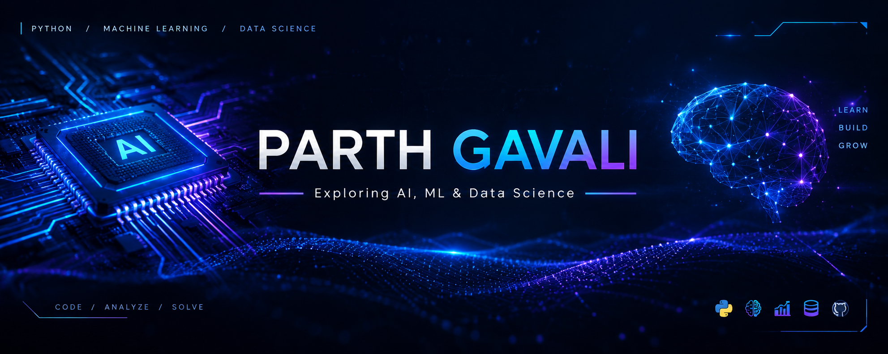

<!--
  PROFILE README: Parth Gavali (OnlyCodingParth)
  Theme "Midnight AI": #020617 background, #58A6FF blue, #A371F7 purple, #22D3EE cyan, #C9D1D9 text.

  Third-party services used (the README stays readable if any of them is down):
    - readme-typing-svg.demolab.com ........ typing animation
    - komarev.com .......................... profile view counter
    - skillicons.dev ....................... technology icons
    - img.shields.io ....................... badges
    - github-readme-stats.vercel.app ....... statistics + top languages cards
    - streak-stats.demolab.com ............. contribution streak card
    - github-readme-activity-graph.vercel.app activity graph
    - Platane/snk (GitHub Action in this repo) contribution snake (switched off until the workflow has run)

  Switching things on: blocks wrapped in "ENABLE-..." markers are hidden until you delete the marker lines.
  See docs/ASSET-GUIDE.md for the full, step-by-step instructions.
-->

<!-- ==================== 01. HEADER ==================== -->

<!-- HEADER-TEXT-FALLBACK:START (delete this block when you enable the custom header image) -->

# PARTH GAVALI

**Exploring AI, ML &amp; Data Science**

Computer Science Engineering Student · Sharad Institute of Technology College of Engineering

<!-- HEADER-TEXT-FALLBACK:END -->

<!-- Custom header image (1600 x 450). Upload assets/header/github-header.png first, then delete the two ENABLE lines. -->
<!-- ENABLE-HEADER-IMAGE

  

ENABLE-HEADER-IMAGE-END -->

<!-- ==================== 02. ANIMATED INTRODUCTION ==================== -->

  
   
  

 

<!-- ==================== 03. ABOUT ME ==================== -->

## About Me

I'm a Computer Science Engineering student at **Sharad Institute of Technology College of Engineering**, with a growing interest in **Artificial Intelligence, Machine Learning and Data Science**.

- Learning Python and strengthening my programming fundamentals
- Practicing Data Structures and Algorithms
- Building academic and personal projects
- Exploring modern technologies, with frontend development and web UI/UX as a secondary interest

<!-- ==================== 04. TECHNOLOGY STACK ==================== -->

## Technology Stack

**Currently Using**

 

**AI / ML Learning Path: Currently Learning**

**Future Learning Goals**

 
Deep Learning frameworks. I have not started these yet.

**Frontend Interests** (secondary)

<!-- ==================== 05. CURRENTLY LEARNING ==================== -->

## Currently Learning

- Python programming
- Mathematics for Machine Learning
- NumPy and Pandas
- Data Structures and Algorithms
- Machine Learning fundamentals

<!-- ==================== 06. GITHUB STATISTICS ==================== -->

## GitHub Statistics

  
  

The languages card shows how much code appears in my public repositories. It is not a measure of skill.

**Commits and contributions are different metrics.** GitHub's contribution calendar also counts pull requests, issues and reviews, so these cards can show different numbers from each other. The figures come from third-party services. If a card fails to load or looks off, my [GitHub profile](https://github.com/OnlyCodingParth) shows the official contribution calendar.

<!-- ==================== 07. CONTRIBUTION STREAK ==================== -->

## Contribution Streak

  

<!-- ==================== 08. ACTIVITY GRAPH ==================== -->

## Activity Graph

  

<!-- ==================== 09. CONTRIBUTION SNAKE ====================
     Switched off on purpose: the images only exist after .github/workflows/snake.yml has run once.
     To enable: run the workflow, confirm the "output" branch has the SVGs, then delete the two ENABLE lines.
     Instructions: docs/ASSET-GUIDE.md, section 7. -->
<!-- ENABLE-SNAKE
## Contribution Snake

  <picture>
    <source media="(prefers-color-scheme: dark)" srcset="https://raw.githubusercontent.com/OnlyCodingParth/OnlyCodingParth/output/github-snake-dark.svg" />
    <source media="(prefers-color-scheme: light)" srcset="https://raw.githubusercontent.com/OnlyCodingParth/OnlyCodingParth/output/github-snake.svg" />
    
  </picture>

ENABLE-SNAKE-END -->

<!-- ==================== 10. FEATURED PROJECTS ==================== -->

## Featured Projects

> #### 01 · Infinity Guide
>   
>
> An educational programming website focused on helping students learn programming concepts.
>
> [Repository](https://github.com/OnlyCodingParth/Infinity-Guide) · [Live Demo](https://onlycodingparth.github.io/Infinity-Guide/)

<!-- ENABLE:  -->

> #### 02 · C Programming
> 
>
> A structured collection of C programming programs and learning materials.
>
> [Repository](https://github.com/OnlyCodingParth/C-Programming)

<!-- ENABLE:  -->

> #### 03 · Data Structures and Algorithms
>   
>
> A collection of Data Structures and Algorithms programs implemented in C.
>
> [Repository](https://github.com/OnlyCodingParth/Data-structure-programs-with-algorithms-)

<!-- ENABLE:  -->

> #### 04 · Agriculture Notes
> 
>
> Organized academic agriculture notes and study materials.
>
> [Repository](https://github.com/OnlyCodingParth/Agriculture-Notes)

<!-- ENABLE:  -->

**In progress:** a structured Python programming repository. I will link it here once it is public.

<!-- ==================== 11. CERTIFICATIONS ==================== -->

## Certifications

### Course and Workshop Certificates

> #### NPTEL · Python for Data Science
> **Type:** Course Certificate · **Duration:** 4 weeks · **Period:** July to August 2026 · **Final score:** 54%

<!-- ENABLE:  -->

> #### Be10x · AI Tools and ChatGPT Workshop
> **Type:** Certificate of Completion · **Date:** 26 April 2026

<!-- ENABLE:  -->

> #### Cyber Security Workshop
> **Organization:** Thetechunique Academy · **Powered by:** TTU Security Pvt. Ltd. · **Date:** 29 May 2026 · **Duration:** 2 hours · **Type:** Certificate of Appreciation

<!-- ENABLE:  -->

### Participation Records

> #### Bharatiya Antariksh Hackathon 2026
> **Presented by:** ISRO · **Powered by:** Hack2skill · **Type:** Certificate of Participation
> Successful idea submission and participation.

<!-- ENABLE:  -->

> #### Music Night
> **Type:** Certificate of Participation

<!-- ENABLE:  -->

<!-- ==================== 12. CONNECT WITH ME ==================== -->

## Connect With Me

  
  

 

<!-- ==================== 13. FOOTER ==================== -->

<!-- Custom footer image (recommended 1600 x 300). Upload assets/footer/github-footer.png first, then delete the two ENABLE lines. -->
<!-- ENABLE-FOOTER-IMAGE

  

ENABLE-FOOTER-IMAGE-END -->

<!-- FOOTER-TEXT-FALLBACK:START (delete this block only if your footer image already contains this text) -->

*Keep Learning. Keep Building. Keep Exploring.*

<!-- FOOTER-TEXT-FALLBACK:END -->
